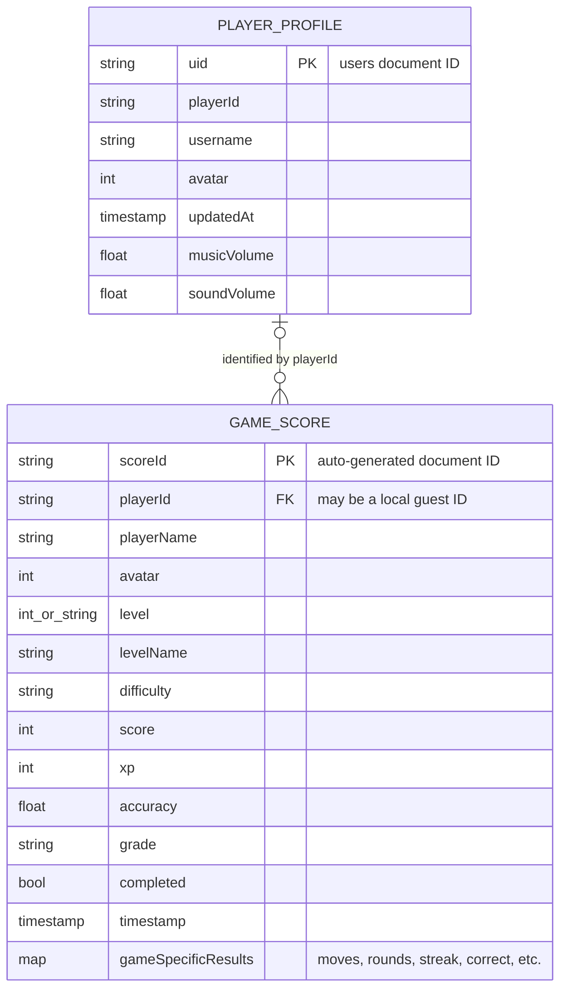
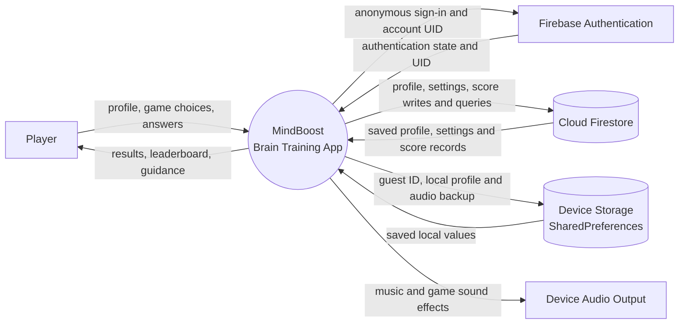
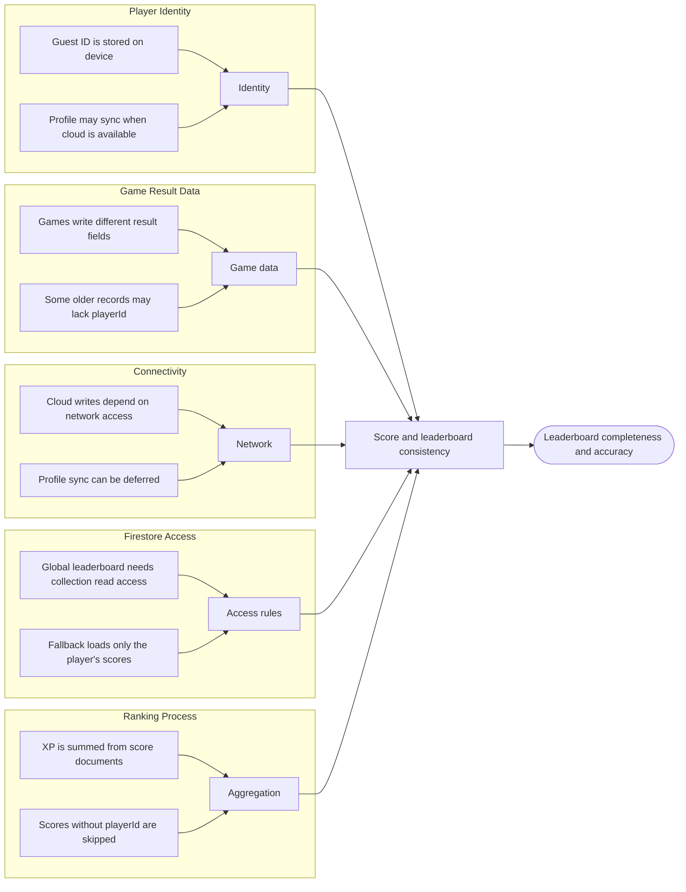

# MindBoost System Diagrams

The following diagrams describe the MindBoost brain-training app implemented in this project. The ERD reflects the Firestore collections and shared score fields found in the source. Firestore is schemaless, so individual game results contain additional fields that depend on the game. The app exposes eight games through its level selector; `Sequence Recall` exists in the source but is not included in that current list.

PNG downloads: [ERD](diagram_images/01_erd.png) · [Context](diagram_images/02_context.png) · [Fishbone](diagram_images/03_fishbone.png) · [Use Case](diagram_images/04_use_case.png) · [Flowchart](diagram_images/05_flowchart.png)

## Figure 1. Entity Relationship Diagram of MindBoost



The ERD shows the relationship between a player profile and saved game results. A profile is stored in `users/{uid}`, while every result is stored as a separate document in `scores/{scoreId}`. A score includes a player ID, display name, and avatar for leaderboard use; guest IDs are possible, so a matching profile document is not guaranteed. Each game writes its own additional result fields.

## Figure 2. Context Diagram of MindBoost



The context diagram places MindBoost at the center and shows its interactions with the player, Firebase services, device storage, and audio output. The player supplies profile information and gameplay input, while the app returns game results and leaderboard data. Firebase Authentication provides player identity, and Firestore stores profiles, audio settings, and score records. SharedPreferences supports local profile and guest data.

## Figure 3. Fishbone Diagram of Factors Affecting Leaderboard Completeness

The fishbone identifies possible factors in how game results are identified, saved, and displayed. These are analysis categories based on the current app design, not a claim that each factor has caused a measured incident.



The fishbone groups the factors into identity, game result data, connectivity, Firestore access, and ranking. Together, these categories show where a result can be associated with a player, persisted to the cloud, included in aggregation, and shown on the leaderboard.

## Figure 4. Use Case Diagram of MindBoost

```mermaid
usecaseDiagram
    actor Player
    actor "Firebase Authentication" as FirebaseAuth
    actor "Cloud Firestore" as Firestore

    rectangle MindBoost {
        (Create or edit profile) as Profile
        (Choose training game) as ChooseGame
        (Choose difficulty) as Difficulty
        (Play game) as Play
        (View game result) as Result
        (View leaderboard) as Leaderboard
        (Read how to play) as Help
        (Adjust audio options) as Audio
        (Navigate between levels) as Navigate
        (Authenticate player) as Authenticate
        (Save profile and settings) as SaveProfile
        (Save game score) as SaveScore
        (Load leaderboard scores) as LoadScores
    }

    Player --> Profile
    Player --> ChooseGame
    Player --> Difficulty
    Player --> Play
    Player --> Result
    Player --> Leaderboard
    Player --> Help
    Player --> Audio
    Player --> Navigate

    Profile ..> Authenticate : <<include>>
    Profile ..> SaveProfile : <<include>>
    Play ..> Difficulty : <<include>>
    Play ..> SaveScore : <<include>>
    Leaderboard ..> LoadScores : <<include>>

    FirebaseAuth --> Authenticate
    Firestore --> SaveProfile
    Firestore --> SaveScore
    Firestore --> LoadScores
```

The use case diagram shows the Player’s main interactions with MindBoost, including profile management, training, results, help, audio options, and leaderboard viewing. Firebase Authentication supports identity checks, while Cloud Firestore supports profile and settings storage, score writes, and leaderboard queries.

## Figure 5. Main Gameplay Flow Diagram

```mermaid
flowchart TD
    start([Start]) --> init[Initialize Firebase]
    init --> home[Display home screen]
    home --> profile{Profile available locally or in Firebase?}
    profile -- No --> edit[Enter player profile]
    edit --> local[Save profile on device]
    local --> sync[Sync profile to Firebase when available]
    sync --> levels[Open level selection]
    profile -- Yes --> levels
    levels --> game[Select one of eight training games]
    game --> difficulty[Select Easy, Medium, or Hard]
    difficulty --> play[Play selected game]
    play --> result[Calculate score, XP, accuracy, and grade]
    result --> save{Can score be saved to Firestore?}
    save -- Yes --> write[Write score document]
    save -- No --> unsaved[Show result; save may be unavailable]
    write --> done[Display game result]
    unsaved --> done
    done --> next{Choose next action}
    next -- Another game --> levels
    next -- Leaderboard --> query[Load global scores or own scores fallback]
    query --> rank[Group scores by player ID and total XP]
    rank --> board[Display leaderboard]
    board --> next
    next -- Exit --> end([End])
```

The flow diagram follows a player from app startup through profile selection, game and difficulty choice, gameplay, and result saving. After the result, the player can start another game, open the leaderboard, or exit. If the global leaderboard query is unavailable, the app can fall back to the player’s own score records with sample rivals.
